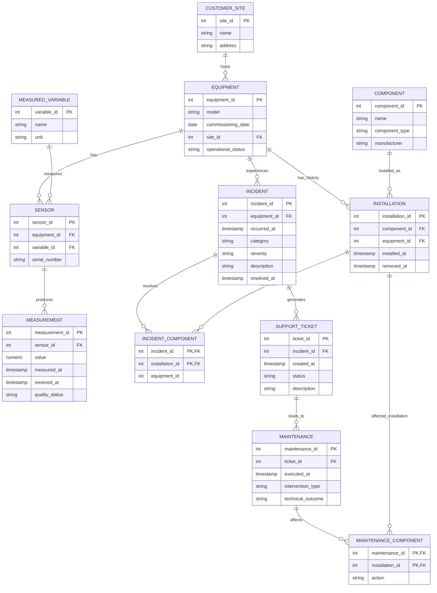
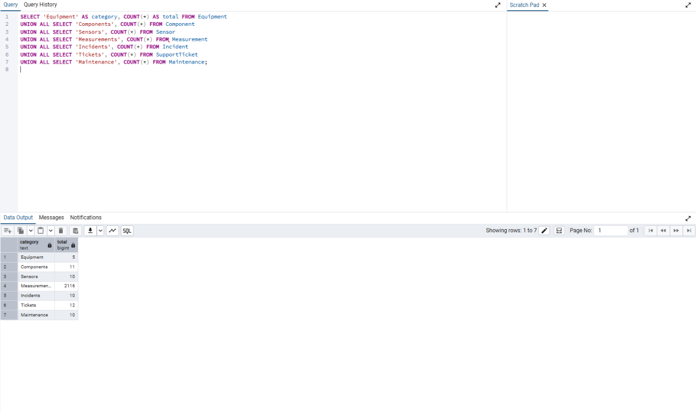
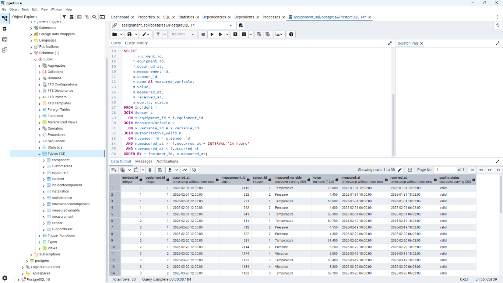
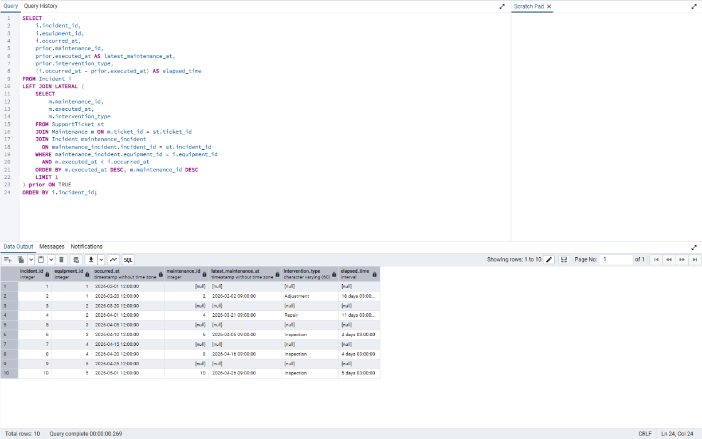

# Database Design and Advanced SQL

##  Context

This project develops a PostgreSQL database for monitoring equipment and
managing its components, sensor readings, incidents, support tickets and
maintenance work.

The database is implemented in PostgreSQL. It keeps a record of past
events instead of replacing them with the latest state. Each component
installation is stored as a separate time interval, so an incident can
be linked to the installation that was active when it occurred.

## 2. Functional Specifications

### 2.1 Equipment and components

The database represents equipment units installed at customer sites,
their technical components and the complete history of component
installations and removals. A component may be transferred and
reinstalled, but it cannot be installed on two equipment units
simultaneously. Historical installation rows must not be overwritten,
and component identifiers must remain consistent in incident and
maintenance records.

### 2.2 Sensors and measurements

Each sensor is linked to an equipment unit and a measured variable with
its unit. Measurements store the sensor, value, measurement timestamp,
reception timestamp and quality status. The design supports late,
duplicate, invalid and missing measurements, including records sharing a
sensor and measurement timestamp but having different reception
timestamps.

### 2.3 Incidents and technical support

Each incident stores its occurrence timestamp, category, severity,
description and optional resolution timestamp. Incidents may involve
several components and may generate multiple support tickets. Each
ticket stores its creation timestamp, status and description.

### 2.4 Maintenance interventions

A support ticket may lead to one or more maintenance interventions. Each
intervention stores its execution timestamp, type, technical outcome and
associated ticket. An intervention may replace several components and
does not necessarily resolve the incident. The model supports
chronological reconstruction of incidents, tickets and interventions.

# 3. Part A - Conceptual and Relational Database Design

## Task A1 - Entity-Relationship Model

### Entities and attributes

| Entity | Attributes | Purpose |
|---|---|---|
| `CustomerSite` | `site_id` (PK), `name`, `address` | Customer locations where equipment is operated. |
| `Equipment` | `equipment_id` (PK), `model`, `commissioning_date`, `site_id` (FK), `operational_status` | Equipment unit monitored by the company. |
| `Component` | `component_id` (PK), `name`, `component_type`, `manufacturer` | Physical components that can be moved between equipment units. |
| `Installation` | `installation_id` (PK), `component_id` (FK), `equipment_id` (FK), `installed_at`, `removed_at` | One historical installation episode for a component. |
| `MeasuredVariable` | `variable_id` (PK), `name`, `unit` | A monitored variable, such as temperature or pressure. |
| `Sensor` | `sensor_id` (PK), `equipment_id` (FK), `variable_id` (FK), `serial_number` | A sensor installed on an equipment unit and configured for one variable. |
| `Measurement` | `measurement_id` (PK), `sensor_id` (FK), `value`, `measured_at`, `received_at`, `quality_status` | A sensor observation, including its measurement and reception timestamps. |
| `Incident` | `incident_id` (PK), `equipment_id` (FK), `occurred_at`, `category`, `severity`, `description`, `resolved_at` | A technical problem reported for an equipment unit. |
| `IncidentComponent` | `incident_id` (PK/FK), `installation_id` (PK/FK), `equipment_id` | Components involved in an incident, linked to the relevant installation episode. |
| `SupportTicket` | `ticket_id` (PK), `incident_id` (FK), `created_at`, `status`, `description` | Support requests associated with incidents. |
| `Maintenance` | `maintenance_id` (PK), `ticket_id` (FK), `executed_at`, `intervention_type`, `technical_outcome` | Interventions performed as a result of a support ticket. |
| `MaintenanceComponent` | `maintenance_id` (PK/FK), `installation_id` (PK/FK), `action` | Installation episodes affected by a maintenance intervention. |

The associative entities resolve many-to-many relationships.
`IncidentComponent` allows one incident to involve several component
installations and one installation to be involved in multiple incidents.
`MaintenanceComponent` allows one intervention to affect several
installation episodes.

### Relationships and cardinalities

| Relationship | Cardinality | Explanation |
|---|---|---|
| CustomerSite --- Equipment | 1:N | One customer site can host several equipment units. |
| Equipment --- Installation | 1:N | An equipment unit can have many installation episodes over time. |
| Component --- Installation | 1:N | A component can be installed, removed and reinstalled during its lifetime. |
| Equipment --- Sensor | 1:N | An equipment unit can have several sensors. |
| MeasuredVariable --- Sensor | 1:N | Several sensors can measure the same variable. |
| Sensor --- Measurement | 1:N | A sensor can produce many measurements. |
| Equipment --- Incident | 1:N | An equipment unit can experience many incidents. |
| Incident --- IncidentComponent | 1:N | An incident can involve multiple installations. |
| Installation --- IncidentComponent | 1:N | An installation can be involved in multiple incidents over time. |
| Incident --- SupportTicket | 1:N | One incident can generate several support tickets. |
| SupportTicket --- Maintenance | 1:N | A ticket can lead to one or more interventions. |
| Maintenance --- MaintenanceComponent | 1:N | An intervention can affect multiple installation episodes. |
| Installation --- MaintenanceComponent | 1:N | An installation episode can be affected by several interventions. |

### Entity-relationship diagram

The ER diagram is provided below in Mermaid format. If the submission
platform does not display Mermaid diagrams, export it as an image and
include that image with the report.



## Task A2 - Relational Schema

-   `CustomerSite(site_id PK, name, address)`

-   `Equipment(equipment_id PK, model, commissioning_date, site_id FK, operational_status)`

-   `Component(component_id PK, name, component_type, manufacturer)`

-   `Installation(installation_id PK, component_id FK, equipment_id FK, installed_at, removed_at)`

-   `MeasuredVariable(variable_id PK, name UQ, unit)`

-   `Sensor(sensor_id PK, equipment_id FK, variable_id FK, serial_number UQ)`

-   `Measurement(measurement_id PK, sensor_id FK, value, measured_at, received_at, quality_status)`

-   `Incident(incident_id PK, equipment_id FK, occurred_at, category, severity, description, resolved_at)`

-   `IncidentComponent(incident_id PK/FK, installation_id PK/FK, equipment_id, FK(incident_id, equipment_id), FK(installation_id, equipment_id))`

-   `SupportTicket(ticket_id PK, incident_id FK, created_at, status, description)`

-   `Maintenance(maintenance_id PK, ticket_id FK, executed_at, intervention_type, technical_outcome)`

-   `MaintenanceComponent(maintenance_id PK/FK, installation_id PK/FK, action)`

## Task A3 - Temporal Consistency

A component must not have a single mutable `equipment_id` as its only
location record. Such a design would overwrite the previous equipment
when the component is transferred. Instead, every installation or
reinstallation creates a new row in `Installation`.

Example:

| installation_id | component_id | equipment_id | installed_at | removed_at |
|---:|---:|---:|---|---|
| 1 | 1 | 1 | 2026-01-01 08:00 | 2026-03-15 10:00 |
| 2 | 1 | 2 | 2026-03-15 10:00 | NULL |

The interval convention is **\[installed_at, removed_at)**:
the start is included and the removal timestamp is excluded. The
component is therefore not installed on both equipment units at the
transfer instant.

An incident is linked through `IncidentComponent` to the exact
`installation_id` that was active when the incident occurred. This
avoids ambiguity when the same physical component is later installed on
another equipment unit.

### What standard constraints can enforce

-   **Primary keys:** uniquely identify rows.

-   **Foreign keys:** ensure that referenced equipment,
    components, installations, incidents and tickets exist.

-   **NOT NULL:** require mandatory values.

-   **UNIQUE:** prevent duplicate identifiers or
    combinations.

-   **CHECK:** validate conditions within one row, such as
    `removed_at > installed_at` and `received_at >= measured_at`.

-   **Composite foreign keys:** ensure that the installation
    and incident refer to the same equipment unit.

### What requires additional temporal validation

A normal `CHECK` constraint cannot compare the installation period in
one row with periods in other rows. It therefore cannot, by itself,
prevent overlapping installation periods for the same component.
PostgreSQL can enforce this with an exclusion constraint over a
timestamp range and GiST index support.

A foreign key also cannot prove that an incident timestamp falls inside
the referenced installation's interval. That condition requires a
trigger or controlled transaction logic. The implementation below uses a
trigger for incident-to-installation temporal validation.

# 4. Part B - SQL Implementation and Synthetic Data

## Task B1 - Database Creation

The script below creates the tables, keys, checks, temporal exclusion
constraint and validation triggers. Run it in a new PostgreSQL database.

```sql

CREATE EXTENSION IF NOT EXISTS btree_gist;


DROP TABLE IF EXISTS MaintenanceComponent CASCADE;

DROP TABLE IF EXISTS Maintenance CASCADE;

DROP TABLE IF EXISTS SupportTicket CASCADE;

DROP TABLE IF EXISTS IncidentComponent CASCADE;

DROP TABLE IF EXISTS Measurement CASCADE;

DROP TABLE IF EXISTS Sensor CASCADE;

DROP TABLE IF EXISTS Incident CASCADE;

DROP TABLE IF EXISTS Installation CASCADE;

DROP TABLE IF EXISTS Component CASCADE;

DROP TABLE IF EXISTS MeasuredVariable CASCADE;

DROP TABLE IF EXISTS Equipment CASCADE;

DROP TABLE IF EXISTS CustomerSite CASCADE;


CREATE TABLE CustomerSite (

    site_id INTEGER GENERATED BY DEFAULT AS IDENTITY PRIMARY KEY,

    name VARCHAR(100) NOT NULL,

    address VARCHAR(200) NOT NULL

);


CREATE TABLE Equipment (

    equipment_id INTEGER GENERATED BY DEFAULT AS IDENTITY PRIMARY KEY,

    model VARCHAR(80) NOT NULL,

    commissioning_date DATE NOT NULL,

    site_id INTEGER NOT NULL REFERENCES CustomerSite(site_id),

    operational_status VARCHAR(20) NOT NULL

        CHECK (operational_status IN ('operational', 'maintenance', 'inactive'))

);


CREATE TABLE Component (

    component_id INTEGER GENERATED BY DEFAULT AS IDENTITY PRIMARY KEY,

    name VARCHAR(100) NOT NULL,

    component_type VARCHAR(80) NOT NULL,

    manufacturer VARCHAR(100) NOT NULL

);


CREATE TABLE Installation (

    installation_id INTEGER GENERATED BY DEFAULT AS IDENTITY PRIMARY KEY,

    component_id INTEGER NOT NULL REFERENCES Component(component_id),

    equipment_id INTEGER NOT NULL REFERENCES Equipment(equipment_id),

    installed_at TIMESTAMP NOT NULL,

    removed_at TIMESTAMP,

    CHECK (removed_at IS NULL OR removed_at > installed_at),

    UNIQUE (installation_id, equipment_id),

    EXCLUDE USING gist (

        component_id WITH =,

        tsrange(installed_at, removed_at, '[)') WITH &&

    )

);


CREATE TABLE MeasuredVariable (

    variable_id INTEGER GENERATED BY DEFAULT AS IDENTITY PRIMARY KEY,

    name VARCHAR(60) NOT NULL UNIQUE,

    unit VARCHAR(20) NOT NULL

);


CREATE TABLE Sensor (

    sensor_id INTEGER GENERATED BY DEFAULT AS IDENTITY PRIMARY KEY,

    equipment_id INTEGER NOT NULL REFERENCES Equipment(equipment_id),

    variable_id INTEGER NOT NULL REFERENCES MeasuredVariable(variable_id),

    serial_number VARCHAR(80) NOT NULL UNIQUE

);


CREATE TABLE Measurement (

    measurement_id BIGINT GENERATED BY DEFAULT AS IDENTITY PRIMARY KEY,

    sensor_id INTEGER NOT NULL REFERENCES Sensor(sensor_id),

    value NUMERIC(12,3) NOT NULL,

    measured_at TIMESTAMP NOT NULL,

    received_at TIMESTAMP NOT NULL,

    quality_status VARCHAR(20) NOT NULL

        CHECK (quality_status IN ('valid', 'invalid', 'suspect')),

    CHECK (received_at >= measured_at)

);


CREATE TABLE Incident (

    incident_id INTEGER GENERATED BY DEFAULT AS IDENTITY PRIMARY KEY,

    equipment_id INTEGER NOT NULL REFERENCES Equipment(equipment_id),

    occurred_at TIMESTAMP NOT NULL,

    category VARCHAR(60) NOT NULL,

    severity VARCHAR(20) NOT NULL

        CHECK (severity IN ('low', 'medium', 'high', 'critical')),

    description TEXT NOT NULL,

    resolved_at TIMESTAMP,

    CHECK (resolved_at IS NULL OR resolved_at >= occurred_at),

    UNIQUE (incident_id, equipment_id)

);


CREATE TABLE IncidentComponent (

    incident_id INTEGER NOT NULL,

    installation_id INTEGER NOT NULL,

    equipment_id INTEGER NOT NULL,

    PRIMARY KEY (incident_id, installation_id),

    FOREIGN KEY (incident_id, equipment_id)

        REFERENCES Incident(incident_id, equipment_id),

    FOREIGN KEY (installation_id, equipment_id)

        REFERENCES Installation(installation_id, equipment_id)

);


CREATE TABLE SupportTicket (

    ticket_id INTEGER GENERATED BY DEFAULT AS IDENTITY PRIMARY KEY,

    incident_id INTEGER NOT NULL REFERENCES Incident(incident_id),

    created_at TIMESTAMP NOT NULL,

    status VARCHAR(20) NOT NULL

        CHECK (status IN ('open', 'in_progress', 'closed', 'waiting')),

    description TEXT NOT NULL

);


CREATE TABLE Maintenance (

    maintenance_id INTEGER GENERATED BY DEFAULT AS IDENTITY PRIMARY KEY,

    ticket_id INTEGER NOT NULL REFERENCES SupportTicket(ticket_id),

    executed_at TIMESTAMP NOT NULL,

    intervention_type VARCHAR(60) NOT NULL,

    technical_outcome TEXT NOT NULL

);


CREATE TABLE MaintenanceComponent (

    maintenance_id INTEGER NOT NULL REFERENCES Maintenance(maintenance_id),

    installation_id INTEGER NOT NULL REFERENCES Installation(installation_id),

    action VARCHAR(40) NOT NULL

        CHECK (action IN ('inspected', 'repaired', 'replaced', 'removed', 'installed')),

    PRIMARY KEY (maintenance_id, installation_id)

);


-- Validate that an incident occurred during every referenced installation.

CREATE OR REPLACE FUNCTION validate_incident_installation()

RETURNS TRIGGER AS $$

DECLARE

    incident_time TIMESTAMP;

    installation_start TIMESTAMP;

    installation_end TIMESTAMP;

    incident_equipment INTEGER;

    installation_equipment INTEGER;

BEGIN

    SELECT occurred_at, equipment_id

      INTO incident_time, incident_equipment

      FROM Incident

     WHERE incident_id = NEW.incident_id;


    SELECT installed_at, removed_at, equipment_id

      INTO installation_start, installation_end, installation_equipment

      FROM Installation

     WHERE installation_id = NEW.installation_id;


    IF incident_equipment IS DISTINCT FROM installation_equipment THEN

        RAISE EXCEPTION 'Incident and installation belong to different equipment units';

    END IF;


    IF incident_time < installation_start

       OR (installation_end IS NOT NULL AND incident_time >= installation_end) THEN

        RAISE EXCEPTION 'Incident timestamp is outside the installation period';

    END IF;


    RETURN NEW;

END;

$$ LANGUAGE plpgsql;


CREATE TRIGGER trg_validate_incident_installation

BEFORE INSERT OR UPDATE ON IncidentComponent

FOR EACH ROW EXECUTE FUNCTION validate_incident_installation();


-- Validate maintenance time and equipment against the installation episode.

CREATE OR REPLACE FUNCTION validate_maintenance_installation()

RETURNS TRIGGER AS $$

DECLARE

    maintenance_time TIMESTAMP;

    installation_start TIMESTAMP;

    installation_end TIMESTAMP;

    installation_equipment INTEGER;

    ticket_equipment INTEGER;

BEGIN

    SELECT m.executed_at, i.equipment_id

      INTO maintenance_time, ticket_equipment

      FROM Maintenance m

      JOIN SupportTicket st ON st.ticket_id = m.ticket_id

      JOIN Incident i ON i.incident_id = st.incident_id

     WHERE m.maintenance_id = NEW.maintenance_id;


    SELECT installed_at, removed_at, equipment_id

      INTO installation_start, installation_end, installation_equipment

      FROM Installation

     WHERE installation_id = NEW.installation_id;


    IF ticket_equipment IS DISTINCT FROM installation_equipment THEN

        RAISE EXCEPTION 'Maintenance ticket and installation belong to different equipment units';

    END IF;


    IF maintenance_time < installation_start

       OR (installation_end IS NOT NULL AND maintenance_time >= installation_end) THEN

        RAISE EXCEPTION 'Maintenance timestamp is outside the installation period';

    END IF;


    RETURN NEW;

END;

$$ LANGUAGE plpgsql;


CREATE TRIGGER trg_validate_maintenance_installation

BEFORE INSERT OR UPDATE ON MaintenanceComponent

FOR EACH ROW EXECUTE FUNCTION validate_maintenance_installation();
```

**Temporal trigger note:** each trigger validates the
relationship when an associative row is inserted or updated. The
maintenance trigger also rejects an installation that belongs to a
different equipment unit from the ticket's incident. In a production
system, changes to the referenced incident, installation or maintenance
timestamps must also be controlled (for example, by making historical
timestamps immutable or by adding complementary update triggers). The
exclusion constraint prevents installation-period overlaps for a
component.

**PostgreSQL execution evidence:** The screenshot below
should show the successful creation of the triggers and the database
tables. Keep it only if it matches the final execution of the script.


## Task B2 - Synthetic Data Generation

The inserts below provide the required minimum data: five equipment
units, ten components, ten sensors, 150 measurements, ten incidents,
twelve support tickets and ten maintenance interventions. Explicit IDs
make the test cases easier to follow.

```sql

INSERT INTO CustomerSite (site_id, name, address) VALUES

(1, 'North Factory', '10 Industrial Road'),

(2, 'South Factory', '25 Manufacturing Avenue'),

(3, 'East Factory', '8 Technology Park');


INSERT INTO Equipment

(equipment_id, model, commissioning_date, site_id, operational_status) VALUES

(1, 'Press-X100', '2023-01-10', 1, 'operational'),

(2, 'Pump-P200', '2023-03-12', 1, 'operational'),

(3, 'Compressor-C300', '2023-05-20', 2, 'maintenance'),

(4, 'Robot-R400', '2024-02-01', 2, 'operational'),

(5, 'Conveyor-C500', '2024-06-15', 3, 'operational');


INSERT INTO Component (component_id, name, component_type, manufacturer) VALUES

(1, 'Bearing A', 'Bearing', 'MechaCo'),

(2, 'Motor B', 'Motor', 'ElectroWorks'),

(3, 'Valve C', 'Valve', 'FlowTech'),

(4, 'Pump D', 'Pump', 'FlowTech'),

(5, 'Gear E', 'Gearbox', 'MechaCo'),

(6, 'Belt F', 'Belt', 'MotionLtd'),

(7, 'Fan G', 'Fan', 'AirSystems'),

(8, 'Seal H', 'Seal', 'FlowTech'),

(9, 'Arm I', 'Robot arm', 'RoboParts'),

(10, 'Sensor mount J', 'Mount', 'MechaCo'),

(11, 'Pump D2', 'Pump', 'FlowTech');


-- Component 1 moves from equipment 1 to equipment 2 on 15 March.

INSERT INTO Installation

(installation_id, component_id, equipment_id, installed_at, removed_at) VALUES

(1, 1, 1, '2026-01-01 08:00', '2026-03-15 10:00'),

(2, 1, 2, '2026-03-15 10:00', NULL),

(3, 2, 1, '2026-01-01 08:00', NULL),

(4, 3, 1, '2026-01-05 08:00', NULL),

(5, 4, 2, '2026-01-10 08:00', '2026-04-02 09:05'),

(6, 5, 2, '2026-01-10 08:00', NULL),

(7, 6, 3, '2026-02-01 08:00', NULL),

(8, 7, 3, '2026-02-01 08:00', NULL),

(9, 8, 4, '2026-02-10 08:00', NULL),

(10, 9, 4, '2026-02-10 08:00', NULL),

(11, 10, 5, '2026-02-15 08:00', NULL),

-- Pump D is removed at 09:05 and Pump D2 is installed on the same equipment.

(12, 11, 2, '2026-04-02 09:05', NULL);


INSERT INTO MeasuredVariable (variable_id, name, unit) VALUES

(1, 'Temperature', 'C'),

(2, 'Pressure', 'bar'),

(3, 'Vibration', 'mm/s');


INSERT INTO Sensor (sensor_id, equipment_id, variable_id, serial_number) VALUES

(1, 1, 1, 'SN-001'), (2, 1, 2, 'SN-002'),

(3, 2, 1, 'SN-003'), (4, 2, 3, 'SN-004'),

(5, 3, 1, 'SN-005'), (6, 3, 2, 'SN-006'),

(7, 4, 3, 'SN-007'), (8, 4, 1, 'SN-008'),

(9, 5, 2, 'SN-009'), (10, 5, 3, 'SN-010');


INSERT INTO Incident

(incident_id, equipment_id, occurred_at, category, severity, description, resolved_at) VALUES

(1, 1, '2026-02-01 12:00', 'Overheating', 'high', 'Bearing temperature increased', NULL),

(2, 1, '2026-02-20 12:00', 'Vibration', 'medium', 'Repeated vibration issue', NULL),

(3, 2, '2026-03-20 12:00', 'Pressure', 'high', 'Pressure instability', NULL),

(4, 2, '2026-04-01 12:00', 'Leak', 'medium', 'Fluid leak detected', '2026-04-02 10:00'),

(5, 3, '2026-04-05 12:00', 'Overheating', 'critical', 'Compressor overheating', NULL),

(6, 3, '2026-04-10 12:00', 'Pressure', 'medium', 'Pressure drop', NULL),

(7, 4, '2026-04-15 12:00', 'Mechanical', 'high', 'Robot arm stopped', NULL),

(8, 4, '2026-04-20 12:00', 'Vibration', 'low', 'Minor vibration', '2026-04-21 12:00'),

(9, 5, '2026-04-25 12:00', 'Pressure', 'medium', 'Conveyor pressure warning', NULL),

(10, 5, '2026-05-01 12:00', 'Sensor', 'low', 'Sensor communication issue', NULL);


-- Incident 1 involves two installation episodes.

-- Incidents 1 and 2 involve component 1 during its first installation.

-- Incident 3 refers to component 1 after its transfer to equipment 2.

INSERT INTO IncidentComponent (incident_id, installation_id, equipment_id) VALUES

(1, 1, 1), (1, 3, 1),

(2, 1, 1),

(3, 2, 2), (3, 5, 2),

(4, 5, 2),

(5, 7, 3), (5, 8, 3),

(6, 7, 3),

(7, 9, 4), (7, 10, 4),

(8, 9, 4),

(9, 11, 5),

(10, 11, 5);


INSERT INTO SupportTicket (ticket_id, incident_id, created_at, status, description) VALUES

(1, 1, '2026-02-01 12:30', 'closed', 'Initial investigation'),

(2, 1, '2026-02-01 13:00', 'in_progress', 'Second support request'),

(3, 2, '2026-02-20 12:30', 'open', 'Vibration investigation'),

(4, 3, '2026-03-20 12:30', 'in_progress', 'Pressure diagnosis'),

(5, 4, '2026-04-01 12:30', 'closed', 'Leak investigation'),

(6, 5, '2026-04-05 12:30', 'open', 'Critical overheating'),

(7, 6, '2026-04-10 12:30', 'waiting', 'Pressure drop review'),

(8, 7, '2026-04-15 12:30', 'in_progress', 'Robot inspection'),

(9, 8, '2026-04-20 12:30', 'closed', 'Vibration review'),

(10, 9, '2026-04-25 12:30', 'open', 'Conveyor pressure'),

(11, 10, '2026-05-01 12:30', 'open', 'Sensor communication'),

(12, 3, '2026-03-20 14:00', 'open', 'Additional pressure complaint');


INSERT INTO Maintenance

(maintenance_id, ticket_id, executed_at, intervention_type, technical_outcome) VALUES

(1, 1, '2026-02-01 15:00', 'Inspection', 'Temperature source inspected; incident left open'),

(2, 2, '2026-02-02 09:00', 'Adjustment', 'Temperature checked'),

(3, 3, '2026-02-21 09:00', 'Inspection', 'Vibration source identified'),

(4, 4, '2026-03-21 09:00', 'Repair', 'Pressure valve adjusted'),

(5, 5, '2026-04-02 09:00', 'Replacement', 'Pump replaced; successor installed at 09:05'),

(6, 6, '2026-04-06 09:00', 'Inspection', 'Further diagnosis required'),

(7, 7, '2026-04-11 09:00', 'Repair', 'Pressure line repaired'),

(8, 8, '2026-04-16 09:00', 'Inspection', 'Robot arm inspected'),

(9, 9, '2026-04-21 09:00', 'Adjustment', 'Vibration reduced'),

(10, 10, '2026-04-26 09:00', 'Inspection', 'Conveyor inspected');


INSERT INTO MaintenanceComponent (maintenance_id, installation_id, action) VALUES

(1, 1, 'inspected'), (2, 1, 'repaired'),

(3, 1, 'inspected'), (4, 2, 'repaired'),

(5, 5, 'replaced'), (6, 7, 'inspected'),

(7, 7, 'repaired'), (8, 9, 'inspected'),

(9, 9, 'repaired'), (10, 11, 'inspected');


-- One reading every 12 hours for each sensor, from 20 January 06:00 through early May.

-- The grid uses 06:00 and 18:00, so the hand-inserted 10:00 and 12:00 rows stay unique.

-- Equipment 5 readings inside incident 10's preceding 24 hours are stored as invalid.

INSERT INTO Measurement

(sensor_id, value, measured_at, received_at, quality_status)

SELECT

    s.sensor_id,

    CASE s.variable_id

        WHEN 1 THEN 60 + (g.n % 15) * 0.7

        WHEN 2 THEN 4 + (g.n % 10) * 0.15

        ELSE 2 + (g.n % 8) * 0.2

    END,

    TIMESTAMP '2026-01-20 06:00' + (g.n * INTERVAL '12 hours'),

    TIMESTAMP '2026-01-20 06:00' + (g.n * INTERVAL '12 hours') + INTERVAL '2 minutes',

    CASE

        WHEN s.equipment_id = 5

         AND TIMESTAMP '2026-01-20 06:00' + (g.n * INTERVAL '12 hours')

             >= TIMESTAMP '2026-04-30 12:00'

         AND TIMESTAMP '2026-01-20 06:00' + (g.n * INTERVAL '12 hours')

             < TIMESTAMP '2026-05-01 12:00'

        THEN 'invalid'

        ELSE 'valid'

    END

FROM Sensor s

CROSS JOIN generate_series(0, 210) AS g(n);


-- Duplicate inside incident 6's window (equipment 3, 10 April 12:00).

-- The later reception is invalid, so the logical measurement is not valid.

INSERT INTO Measurement

(sensor_id, value, measured_at, received_at, quality_status) VALUES

(5, 88.0, '2026-04-10 10:00', '2026-04-10 10:01', 'valid'),

(5, 89.0, '2026-04-10 10:00', '2026-04-10 10:05', 'invalid'),

-- Tie inside incident 2's window. measurement_id is the deterministic tie-breaker.

(2, 5.1, '2026-02-20 10:00', '2026-02-20 10:05', 'valid'),

(2, 5.2, '2026-02-20 10:00', '2026-02-20 10:05', 'valid'),

-- Exactly 24 hours before incident 1, and exactly at the incident timestamp.

(1, 75.0, '2026-01-31 12:00', '2026-01-31 12:02', 'valid'),

(1, 76.0, '2026-02-01 12:00', '2026-02-01 12:01', 'valid');
```

The generated series contains 2,110 rows (211 timestamps × 10 sensors),
plus six deliberate test rows, for 2,116 measurements in total. This
exceeds the required minimum of 150. Every incident except incident 10
has valid readings in its preceding 24 hours. Incident 10's equipment-5
readings in that window are stored, but they are marked `invalid`.

Maintenance 5 replaces pump installation 5 at 09:00. That episode is
closed at 09:05, and installation 12 starts at the same instant with the
successor pump. The maintenance row stays attached to installation 5,
which still covers 09:00 under the half-open interval.

**PostgreSQL execution evidence:** The deliberate
measurement insert completed successfully, adding six rows for
duplicate, tie-breaking and boundary scenarios.


### Minimum-count verification

```sql

SELECT 'Equipment' AS category, COUNT(*) AS total FROM Equipment

UNION ALL SELECT 'Components', COUNT(*) FROM Component

UNION ALL SELECT 'Sensors', COUNT(*) FROM Sensor

UNION ALL SELECT 'Measurements', COUNT(*) FROM Measurement

UNION ALL SELECT 'Incidents', COUNT(*) FROM Incident

UNION ALL SELECT 'Tickets', COUNT(*) FROM SupportTicket

UNION ALL SELECT 'Maintenance', COUNT(*) FROM Maintenance;
```

Expected minimums:

| Category | Required minimum |
|---|---:|
| Equipment | 5 |
| Components | 10 |
| Sensors | 10 |
| Measurements | 150 |
| Incidents | 10 |
| Support tickets | 12 |
| Maintenance interventions | 10 |

The dataset contains 5 equipment units, 11 components, 10 sensors, 2,116
measurements, 10 incidents, 12 support tickets and 10 maintenance
interventions.



### Required situations represented

| Required situation | Example in the data |
|---|---|
| Component transfer | Component 1: installation 1 on equipment 1, then installation 2 on equipment 2. |
| Two incidents on one component | Incidents 1 and 2 both refer to installation 1. |
| One incident with several components | Incident 1 refers to installations 1 and 3. |
| Several tickets for one incident | Incident 1 has tickets 1 and 2; incident 3 has tickets 4 and 12. |
| Duplicate measurements | Sensor 5 at `2026-04-10 10:00` (inside incident 6); sensor 2 at `2026-02-20 10:00` (inside incident 2). |
| Invalid measurement | The later received version for sensor 5 is `invalid`. Equipment 5 readings in the 24 hours before incident 10 are also `invalid`. |
| No valid readings in previous 24 hours | Incident 10 has sensor rows in its preceding interval, but none of them are valid. |
| Maintenance does not close incident | Maintenance 6 follows incident 5, and incident 5 stays unresolved (`resolved_at IS NULL`). |
| Component replacement keeps history | Installation 5 closes at `2026-04-02 09:05`. Installation 12 opens then for the replacement pump. |

# 5. SQL Analysis

## Query C1 - Sensor Measurements Before Incidents

This query uses the same versioning rule as C2 and C3: keep the latest
received version, then keep only valid readings. The interval is
`[occurred_at - 24 hours, occurred_at)`, so the lower boundary is
included and the incident timestamp is not.

```sql

WITH ranked_measurements AS (

    SELECT

        m.*,

        ROW_NUMBER() OVER (

            PARTITION BY sensor_id, measured_at

            ORDER BY received_at DESC, measurement_id DESC

        ) AS version_rank

    FROM Measurement m

),

authoritative_valid AS (

    SELECT *

    FROM ranked_measurements

    WHERE version_rank = 1

      AND quality_status = 'valid'

)

SELECT

    i.incident_id,

    i.equipment_id,

    i.occurred_at,

    m.measurement_id,

    s.sensor_id,

    v.name AS measured_variable,

    m.value,

    m.measured_at,

    m.received_at,

    m.quality_status

FROM Incident i

JOIN Sensor s

  ON s.equipment_id = i.equipment_id

JOIN MeasuredVariable v

  ON v.variable_id = s.variable_id

JOIN authoritative_valid m

  ON m.sensor_id = s.sensor_id

 AND m.measured_at >= i.occurred_at - INTERVAL '24 hours'

 AND m.measured_at < i.occurred_at

ORDER BY i.incident_id, m.measured_at;
```

**PostgreSQL execution evidence:** C1 returned 38 rows. The
results exclude measurements at the incident timestamp and include only
readings associated with the matching equipment unit.




**Explanation:** Joining through `equipment_id` prevents
readings from other equipment from being included. Incident 6 does not
include sensor 5's `10:00` reading because its later version is invalid.
Since this is an inner join, incidents without valid readings (such as
incident 10) do not appear in C1; C3 handles that case separately.

## Query C2 - Duplicate Measurement Management

A logical duplicate is defined by the same `sensor_id` and
`measured_at`. The authoritative row is the one with the latest
`received_at`. If reception timestamps are tied, the highest
`measurement_id` is selected as a deterministic tie-breaker.

```sql

WITH ranked_measurements AS (

    SELECT

        m.*,

        ROW_NUMBER() OVER (

            PARTITION BY sensor_id, measured_at

            ORDER BY received_at DESC, measurement_id DESC

        ) AS version_rank

    FROM Measurement m

),

authoritative_measurements AS (

    SELECT *

    FROM ranked_measurements

    WHERE version_rank = 1

)

SELECT

    measurement_id,

    sensor_id,

    value,

    measured_at,

    received_at,

    quality_status

FROM authoritative_measurements

WHERE quality_status = 'valid'

ORDER BY sensor_id, measured_at;
```


**Explanation:** For sensor 5 at `2026-04-10 10:00`, the
invalid row was received later, so it is authoritative and the logical
measurement is excluded. For sensor 2, the reception timestamps are tied
and the larger `measurement_id` breaks the tie.

Filtering quality before ranking would incorrectly promote the older
valid row and treat it as the final reading.

## Query C3 - Equipment Monitoring Indicators

This query calculates the count, minimum, maximum, average and latest
value for each incident and measured variable. It also keeps incidents
whose valid-reading count is zero.

```sql

WITH ranked_measurements AS (

    SELECT

        m.*,

        ROW_NUMBER() OVER (

            PARTITION BY sensor_id, measured_at

            ORDER BY received_at DESC, measurement_id DESC

        ) AS version_rank

    FROM Measurement m

),

authoritative_valid AS (

    SELECT

        rm.*,

        s.equipment_id,

        s.variable_id

    FROM ranked_measurements rm

    JOIN Sensor s ON s.sensor_id = rm.sensor_id

    WHERE rm.version_rank = 1

      AND rm.quality_status = 'valid'

),

incident_measurements AS (

    SELECT

        i.incident_id,

        av.variable_id,

        av.value,

        av.measured_at,

        av.measurement_id

    FROM Incident i

    LEFT JOIN authoritative_valid av

      ON av.equipment_id = i.equipment_id

     AND av.measured_at >= i.occurred_at - INTERVAL '24 hours'

     AND av.measured_at < i.occurred_at

),

aggregated AS (

    SELECT

        incident_id,

        variable_id,

        COUNT(value) AS measurement_count,

        MIN(value) AS minimum_value,

        MAX(value) AS maximum_value,

        AVG(value) AS average_value

    FROM incident_measurements

    GROUP BY incident_id, variable_id

),

latest AS (

    SELECT DISTINCT ON (incident_id, variable_id)

        incident_id,

        variable_id,

        value AS most_recent_value,

        measured_at AS most_recent_timestamp

    FROM incident_measurements

    WHERE value IS NOT NULL

    ORDER BY incident_id, variable_id, measured_at DESC, measurement_id DESC

),

incident_variables AS (

    SELECT DISTINCT

        i.incident_id,

        v.variable_id,

        v.name AS variable_name,

        v.unit

    FROM Incident i

    JOIN Sensor s ON s.equipment_id = i.equipment_id

    JOIN MeasuredVariable v ON v.variable_id = s.variable_id

)

SELECT

    iv.incident_id,

    iv.variable_name,

    iv.unit,

    COALESCE(a.measurement_count, 0) AS measurement_count,

    a.minimum_value,

    a.maximum_value,

    a.average_value,

    l.most_recent_value,

    l.most_recent_timestamp

FROM incident_variables iv

LEFT JOIN aggregated a

  ON a.incident_id = iv.incident_id

 AND a.variable_id = iv.variable_id

LEFT JOIN latest l

  ON l.incident_id = iv.incident_id

 AND l.variable_id = iv.variable_id

ORDER BY iv.incident_id, iv.variable_name;
```


**Explanation:** Versions are ranked before invalid rows are
removed. The aggregation does not join tickets or component links, so
one incident cannot multiply the same measurement through several
relationships. `incident_variables` keeps the variables available on
each equipment unit visible; when no valid reading exists, the count is
`0` and the other indicators are `NULL`.

## Query C4 - Maintenance History Analysis

This query finds the latest intervention on the same equipment unit
before each incident, while keeping incidents with no earlier
maintenance.

```sql

SELECT

    i.incident_id,

    i.equipment_id,

    i.occurred_at,

    prior.maintenance_id,

    prior.executed_at AS latest_maintenance_at,

    prior.intervention_type,

    (i.occurred_at - prior.executed_at) AS elapsed_time

FROM Incident i

LEFT JOIN LATERAL (

    SELECT

        m.maintenance_id,

        m.executed_at,

        m.intervention_type

    FROM SupportTicket st

    JOIN Maintenance m ON m.ticket_id = st.ticket_id

    JOIN Incident maintenance_incident

      ON maintenance_incident.incident_id = st.incident_id

    WHERE maintenance_incident.equipment_id = i.equipment_id

      AND m.executed_at < i.occurred_at

    ORDER BY m.executed_at DESC, m.maintenance_id DESC

    LIMIT 1

) prior ON TRUE

ORDER BY i.incident_id;
```



**Explanation:** `LEFT JOIN LATERAL` selects one prior
intervention per incident, ordered by execution time. The equipment is
obtained through the incident linked to the ticket. If no intervention
qualifies, the maintenance columns are `NULL`.

## Query C5 - Data Consistency Verification

### 1. Overlapping installation periods

The exclusion constraint in the creation script prevents overlaps for
the same component. The following query can also be used to audit
existing data:

```sql

SELECT

    a.component_id,

    a.installation_id AS installation_a,

    b.installation_id AS installation_b,

    a.installed_at AS a_start,

    a.removed_at AS a_end,

    b.installed_at AS b_start,

    b.removed_at AS b_end

FROM Installation a

JOIN Installation b

  ON a.component_id = b.component_id

 AND a.installation_id < b.installation_id

 AND tsrange(a.installed_at, a.removed_at, '[)')

     && tsrange(b.installed_at, b.removed_at, '[)');
```


**Consequence:** Overlapping periods can make it impossible
to determine which equipment unit physically contained a component at a
given time. This can lead to incorrect incident attribution and
unreliable maintenance history.

### 2. Incidents outside actual installation periods

```sql

SELECT

    ic.incident_id,

    ic.installation_id,

    i.occurred_at,

    ins.installed_at,

    ins.removed_at

FROM IncidentComponent ic

JOIN Incident i ON i.incident_id = ic.incident_id

JOIN Installation ins ON ins.installation_id = ic.installation_id

WHERE i.equipment_id <> ins.equipment_id

   OR i.occurred_at < ins.installed_at

   OR (ins.removed_at IS NOT NULL AND i.occurred_at >= ins.removed_at);
```

   **Actual result:** No inconsistent rows were returned.

   

**Consequence:** An incident may be attributed to a
component that was not installed on the equipment at the time. This
corrupts root-cause analysis and component reliability statistics.

### 3. Inconsistent measurement timestamps

```sql

SELECT *

FROM Measurement

WHERE received_at < measured_at;
```

**Actual result:** No rows were returned. The empty result
is consistent with the `received_at >= measured_at` CHECK constraint.


The row-level CHECK constraint should prevent this inconsistency. The
query is useful as an audit if data were imported from an external
source or constraints were disabled during loading.

**Consequence:** Incorrect timestamp ordering can distort
latency analysis and the reconstruction of events.

### 4. Missing or inconsistent incident-ticket-maintenance relationships

```sql

-- Incidents without a support ticket

SELECT i.incident_id

FROM Incident i

LEFT JOIN SupportTicket st ON st.incident_id = i.incident_id

WHERE st.ticket_id IS NULL;
```

**Actual result:** No incidents without support tickets were
returned.


```sql

-- Tickets without a maintenance intervention

SELECT st.ticket_id, st.incident_id

FROM SupportTicket st

LEFT JOIN Maintenance m ON m.ticket_id = st.ticket_id

WHERE m.maintenance_id IS NULL;
```

**Actual result:** Tickets 11 and 12 are returned as tickets
without a maintenance intervention.


```sql

-- Maintenance executed before its ticket was created

SELECT m.maintenance_id, m.executed_at, st.created_at

FROM Maintenance m

JOIN SupportTicket st ON st.ticket_id = m.ticket_id

WHERE m.executed_at < st.created_at;
```

**Actual result:** No maintenance rows were executed before
their ticket was created.


**Consequence:** Missing relationships make the intervention
history incomplete. A maintenance action executed before the ticket was
created may indicate an incorrect timestamp or an incomplete import
process. A ticket without maintenance is not automatically an error,
because not every support request must lead to an intervention. On this
dataset the third query returns no rows: maintenance 1 is executed at
15:00, after ticket 1 was opened at 12:30.

# 6. Part D - Validation and Critical Analysis

## Task D1 - SQL Validation

Run these scenarios in PostgreSQL 16 after executing the table-creation
and data-insertion scripts. Put each statement expected to fail in its
own transaction, then roll it back. Keep the corresponding pgAdmin
output and screenshot for each test in the submitted work.

### Scenario 1 --- Measurement exactly 24 hours before an incident

**Test data:** Incident 1 occurs at `2026-02-01 12:00`. A
valid measurement for its equipment is recorded at `2026-01-31 12:00`.

**Test query:**

```sql

SELECT measurement_id, sensor_id, measured_at, quality_status

FROM Measurement

WHERE sensor_id = 1

  AND measured_at = TIMESTAMP '2026-01-31 12:00'

  AND measured_at >= TIMESTAMP '2026-02-01 12:00' - INTERVAL '24 hours'

  AND measured_at < TIMESTAMP '2026-02-01 12:00'

  AND quality_status = 'valid';
```

-   **Expected result:** The measurement at exactly
    `2026-01-31 12:00` is included. Other valid readings also fall in
    this window (18:00 the day before, and 06:00 on the incident day).
    This query isolates the boundary row.

-   **Actual result:** One row, with
    `measurement_id = 2115`, `sensor_id = 1`,
    `measured_at = 2026-01-31 12:00`, and `quality_status = valid`.


-   **Interpretation:** The lower boundary is inclusive
    (`>=`), so a reading exactly 24 hours before the incident belongs to
    the analysis window.

### Scenario 2 --- Measurement exactly at the incident timestamp

**Test data:** Incident 1 occurs at `2026-02-01 12:00`. A
valid measurement exists at exactly `2026-02-01 12:00`.

**Test query:**

```sql

SELECT measurement_id, sensor_id, measured_at

FROM Measurement

WHERE sensor_id = 1

  AND measured_at = TIMESTAMP '2026-02-01 12:00'

  AND measured_at >= TIMESTAMP '2026-02-01 12:00' - INTERVAL '24 hours'

  AND measured_at < TIMESTAMP '2026-02-01 12:00';
```

-   **Expected result:** No row. The measurement exists in
    the table, but the window predicate excludes it.

-   **Actual result:** No rows.


-   **Interpretation:** The upper boundary is exclusive
    (`<`). This follows the requirement to retrieve readings before the
    incident, not at or after it.

### Scenario 3 --- Component removed immediately before an incident

**Test data:** Installation 1 ends at `2026-03-15 10:00`. A
temporary incident on equipment 1 at exactly `2026-03-15 10:00` must not
reference installation 1, because the interval is half-open.

**Test statement:**

```sql

BEGIN;


INSERT INTO Incident

    (incident_id, equipment_id, occurred_at, category, severity, description)

VALUES

    (11, 1, '2026-03-15 10:00', 'Validation', 'low',

     'Temporary incident for temporal validation');


INSERT INTO IncidentComponent (incident_id, installation_id, equipment_id)

VALUES (11, 1, 1);


ROLLBACK;
```

-   **Expected result:** The insert is rejected by the
    temporal trigger because the incident occurs at the exclusive end of
    installation 1.

-   **Actual result:** The insert fails with
    `Incident timestamp is outside the installation period`.


-   **Interpretation:** The composite foreign key prevents
    cross-equipment attribution in ordinary inserts. Here, both rows use
    equipment 1, so the temporal trigger demonstrates that the removal
    timestamp is excluded from the installation period.

### Scenario 4 --- Multiple support tickets for the same incident

**Test query:**

```sql

SELECT incident_id, COUNT(*) AS ticket_count

FROM SupportTicket

WHERE incident_id = 1

GROUP BY incident_id;
```

-   **Expected result:** Incident 1 has two tickets.

-   **Actual result:** One result row: `incident_id = 1`,
    `ticket_count = 2`.


-   **Interpretation:** The one-to-many relationship is
    working. `SupportTicket.incident_id` is a foreign key but is not
    unique, so multiple tickets can reference the same incident.

### Scenario 5 --- Two versions of one measurement; latest version is invalid

**Test query:**

```sql

WITH ranked AS (

    SELECT m.*,

           ROW_NUMBER() OVER (

               PARTITION BY sensor_id, measured_at

               ORDER BY received_at DESC, measurement_id DESC

           ) AS rn

    FROM Measurement m

)

SELECT measurement_id, sensor_id, measured_at, received_at, quality_status

FROM ranked

WHERE rn = 1

  AND sensor_id = 5

  AND measured_at = TIMESTAMP '2026-04-10 10:00';
```

-   **Expected result:** Only the later-received version is
    selected, and its quality status is `invalid`.

-   **Actual result:** One row, `measurement_id = 2112`,
    `sensor_id = 5`, `measured_at = 2026-04-10 10:00`,
    `received_at = 2026-04-10 10:05`, and `quality_status = invalid`.


-   **Interpretation:** The authoritative version is
    selected before quality filtering. Therefore, the older valid
    version is not incorrectly used as a replacement for the newer
    invalid version.

### Validation summary

| Scenario | Expected result | What it validates |
|---|---|---|
| Exactly 24 hours before | Included | Inclusive lower time boundary |
| Exactly at incident time | Excluded | Exclusive upper time boundary |
| Component removed at incident time | Rejected | Installation period and equipment consistency |
| Multiple tickets | Two tickets returned | One-to-many ticket relationship |
| Latest duplicate invalid | Latest version selected, then excluded from valid analysis | Correct order of deduplication and quality filtering |

**Execution note:** Run the tests in a transaction and use
`ROLLBACK` after tests that intentionally cause errors, so test records
do not alter the main dataset. In the report, describe as an actual
result only what PostgreSQL returned when you ran the test. If you have
not run a scenario yet, leave its actual-result field to complete after
execution.

## Task D2 - Critical Analysis

### 1. Why can SQL queries containing several joins produce incorrect aggregates even when all join conditions are syntactically valid?

Several joins can multiply rows when the relationships are one-to-many
or many-to-many. This is known as join fan-out.

For example, incident 1 has two component associations and two support
tickets. Joining `Incident`, `IncidentComponent` and `SupportTicket`
produces four combinations for that incident. If measurements are also
joined, each measurement can be repeated across those combinations.

An aggregate such as `COUNT(*)` or `SUM(value)` may therefore count the
same measurement multiple times. The SQL is syntactically valid, and
each join condition may be correct, but the resulting row set has a
different granularity from the intended measurement-level analysis.

In this implementation, the C3 query first deduplicates measurements and
aggregates them by incident and measured variable. It does not join
tickets or incident-component rows into the measurement aggregation.
This prevents the additional relationships from multiplying the
measurement rows.

### 2. What are the limitations of foreign keys for ensuring temporal consistency of industrial information?

Foreign keys verify that a referenced row exists. They do not normally
verify whether the referenced row was valid at a particular point in
time.

For example, a foreign key can ensure that an incident references an
existing installation. It cannot, on its own, guarantee that the
incident occurred between `installed_at` and `removed_at`.

Similarly, a foreign key cannot prevent two installation rows for the
same component from having overlapping periods. These are temporal rules
involving comparisons between timestamps and, in some cases, multiple
rows.

The implementation addresses these limitations in different ways:

-   An exclusion constraint prevents overlapping installation ranges for
    the same component.

-   A trigger checks that an incident occurred within the referenced
    installation period.

-   Composite foreign keys ensure that the incident and installation
    refer to the same equipment unit.

These controls improve consistency, but historical timestamp changes
must also be controlled. In a production database, historical
installation and incident records should be protected against
unauthorized updates.

### 3. How could this relational database architecture support predictive maintenance, anomaly detection and equipment reliability analysis?

The stored history can also be used for further analysis.

For predictive maintenance, measurements can be collected over time and
linked to equipment, sensors and measured variables. Historical
maintenance interventions and incidents can be used as outcome
information for models that estimate the probability of future failures.

For anomaly detection, valid authoritative measurements can be analyzed
to identify unusual temperature, pressure or vibration patterns. The
duplicate-handling rule is important because an obsolete measurement
should not be treated as the final observation when a later version
exists.

For reliability analysis, incidents, installation histories and
maintenance interventions can be used to calculate failure frequency,
time between failures, component lifetime and maintenance effectiveness.
Because component transfers are preserved as separate installation
episodes, analysis can distinguish a component's performance on
different equipment units.

The database can also be extended with additional fields such as failure
mode, downtime duration, replacement cost, operating hours and
maintenance labor. These would support more detailed reliability
indicators and predictive models.

## Final grading audit

| Worksheet requirement | Location in this document | Coverage in document | Remaining action |
|---|---|---|---|
| Project context and centralized database objective | 1. Project Context | Addressed | None |
| Task A1: complete ERD with entities, attributes, keys, cardinalities and historical installations | Task A1 - Entity-Relationship Model | Addressed | Render the Mermaid diagram if the submission format does not render Mermaid automatically. |
| Task A2: relational schema derived from the conceptual model | Task A2 - Relational Schema | Addressed | None |
| Task A3: preserve transfer history, prevent incorrect incident associations, and distinguish standard constraints from additional validation | Task A3 - Temporal Consistency | Addressed | None |
| Task B1: complete SQL creation script with required tables, primary keys and foreign keys | Task B1 - Database Creation | Addressed | Confirm the script is run on PostgreSQL 16 or the version required by the course. |
| Task B2: minimum data quantities | Task B2 - Synthetic Data Generation; Minimum-count verification | Addressed | None |
| Task B2: transfer, repeated component incidents, multi-component incident, repeated tickets, duplicate and invalid measurements, no-valid-reading incident, and unresolved incident after maintenance | Task B2 - Synthetic Data Generation; Required situations represented | Addressed | None |
| Query C1: valid measurements in the preceding 24 hours for each incident and equipment | Query C1 - Sensor Measurements Before Incidents | Addressed | None |
| Query C2: authoritative duplicate selection, tie-breaker, post-selection quality filtering and explanation | Query C2 - Duplicate Measurement Management | Addressed | None |
| Query C3: all required indicators, including incidents with no valid readings and protection against join fan-out | Query C3 - Equipment Monitoring Indicators | Addressed | None |
| Query C4: latest prior maintenance on the same equipment, elapsed time, and incidents without prior maintenance | Query C4 - Maintenance History Analysis | Addressed | None |
| Query C5: four inconsistency checks and consequences | Query C5 - Data Consistency Verification | Addressed | None |
| Task D1: five targeted scenarios with test data, expected result, actual result and explanation | Task D1 - SQL Validation | Addressed | Keep the five supplied screenshots with the document. |
| Task D2: three critical-analysis questions supported by implementation examples | Task D2 - Critical Analysis | Addressed | None |

### Submission-readiness conclusion

The sections in this document cover the requirements listed in the
worksheet. This checklist is a guide to the document's coverage; it does
not replace testing the SQL in PostgreSQL. Before submitting, run the
scripts and queries again from a clean database, check that the results
match the explanations, and make sure every referenced screenshot is
included. Also export the Mermaid ER diagram as an image if the
submission platform does not render Mermaid.

**---**

**AI was used during the preparation of this assignment specifically to help with the generation of data for testing  as well as for language refinement and document formatting.**